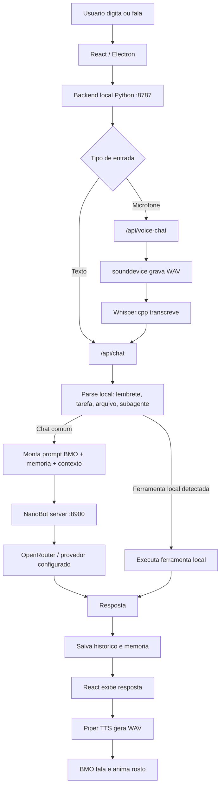

# Auditoria tecnica do BMO

Data da auditoria: 2026-06-04

Objetivo: identificar por que o BMO ficou mais lento, menos estavel e com respostas piores que o NanoBot original, sem adicionar novas funcionalidades e sem alterar a interface.

## Resumo executivo

O BMO estava pior que o NanoBot original por quatro causas principais:

1. O historico era salvo, mas nao era enviado corretamente ao modelo.
2. A correcao anterior de contexto passou varias mensagens ao motor interno, mas o endpoint usado pelo NanoBot neste projeto aceita apenas uma mensagem de usuario em alguns modelos/provedores.
3. A configuracao tentava primeiro modelos pagos/indisponiveis antes do modelo gratis funcional, causando cascata de erros, reinicios do motor e atrasos de 30 a 60 segundos.
4. Existiam processos `nanobot serve` orfaos e varreduras repetidas de vozes, gerando ruido, logs grandes e risco de consumo progressivo.

Depois das correcoes aplicadas nesta auditoria:

- O contexto passou a ser enviado em uma unica mensagem compativel com o NanoBot.
- A segunda pergunta contextual voltou a funcionar.
- O modelo principal foi normalizado para `openai/gpt-oss-120b:free`.
- Os fallbacks pagos/indisponiveis foram removidos da ordem principal.
- A lista de vozes passou a usar cache.
- OpenWakeWord foi instalado e validado no ambiente de desenvolvimento.

## Fluxo atual do sistema

## Medicoes realizadas

Ambiente: projeto em desenvolvimento, backend local iniciado em `C:\Users\USER\Documents\Codex\bmo`.

| Etapa | Resultado medido | Observacao |
|---|---:|---|
| Primeira chamada de chat apos backend ativo | 19,79 s | Inclui aquecimento/uso inicial do motor interno |
| Segunda chamada contextual na mesma sessao | 6,41 s | Contexto funcionou e respondeu sobre o mesmo assunto |
| Geracao + reproducao Piper curta | 4,92 s | Inclui tempo de gerar WAV e tocar o audio |
| Teste de microfone sem fala | 2,83 s | Falhou corretamente por volume baixo, sem travar |
| `/api/settings` | 356 ms | Aceitavel |
| `/api/voices` apos cache | 435 ms | Ainda depende de disco, mas sem log repetitivo |
| `/api/history` | 443 ms | Historico ja tem cerca de 130 KB |
| `/api/system` | 325 ms | Inclui status, wake word, paths e leitura de recursos |

## Comparacao com NanoBot original

O NanoBot original trabalha como CLI com uma sessao unica e passa o contexto de forma natural dentro da propria sessao. No BMO, a interface havia introduzido uma camada extra:

- React envia `sessionId`.
- Backend salva em `history.json`.
- Mas o prompt enviado ao modelo nao carregava o historico corretamente.

Resultado: o BMO parecia "sem memoria" mesmo tendo historico salvo.

Tambem havia diferenca de desempenho:

- NanoBot original: uma chamada direta de agente.
- BMO antes da correcao: chamada React -> backend -> NanoBot server -> modelo. Em caso de erro, reiniciava o NanoBot e testava varios modelos/chaves.

Essa cascata era a principal causa de respostas em 1 a 2 minutos.

## Causa raiz do problema de contexto

Arquivo envolvido:

- `backend/bmo_backend.py`

Problema anterior:

- `save_chat_turn()` gravava a conversa em `history.json`.
- `ask_nanobot()` chamava o motor usando apenas a mensagem atual.
- Perguntas como "O que voce acha?" chegavam ao modelo sem o assunto anterior.

Problema adicional encontrado:

- A primeira correcao enviava varias mensagens ao motor.
- O provedor retornava: `Only a single user message is supported`.
- O BMO entao tentava varios modelos, reiniciava o motor e ficava lento.

Correcao aplicada:

- O contexto recente agora e condensado em texto e enviado como uma unica mensagem de usuario.
- Isso preserva contexto sem quebrar a compatibilidade do NanoBot/OpenRouter.

## Causa raiz da lentidao

Logs mostraram a seguinte cascata antes da correcao:

1. Tenta modelo indisponivel.
2. Recebe erro do provedor.
3. Reinicia o NanoBot para aplicar outro modelo.
4. Tenta outro modelo indisponivel.
5. Repete varias vezes.
6. So depois cai em `openai/gpt-oss-120b:free`, que funcionava.

Isso adicionava dezenas de segundos por mensagem.

Correcao aplicada:

- Modelo principal: `openai/gpt-oss-120b:free`.
- Fallbacks: apenas modelos gratis conhecidos.
- Removidos da ordem principal os modelos pagos/sem permissao que estavam falhando.

## Wake word

Arquivo envolvido:

- `backend/bmo_backend.py`

Estado encontrado:

- O codigo tentava importar `openwakeword`.
- O pacote nao estava instalado.
- Depois de instalar, os modelos auxiliares tambem estavam ausentes.

Correcao aplicada no ambiente:

- Instalado `openwakeword`.
- Baixados modelos auxiliares via `download_models()`.
- Validado carregamento de `runtime/wakeword.onnx`.
- Atualizado `build-electron.bat` para empacotar `openwakeword`, `onnxruntime`, `scipy` e `sklearn` no futuro.

Status atual:

- `/api/system` retorna wake word disponivel, dependencia presente e listener rodando.

## Processos e estabilidade

Foram encontrados processos relacionados:

- Backend BMO em `:8787`.
- NanoBot server em `:8900`.
- Dois processos externos `nanobot agent` que nao pertencem diretamente ao BMO de desenvolvimento.
- Um servidor NanoBot orfao em `:8900` foi encontrado antes do backend ser reiniciado.

Risco:

- Processos orfaos podem manter porta ocupada.
- Podem causar falsa impressao de app travado.
- Podem aumentar consumo se multiplas instancias forem abertas.

Mitigacao existente:

- Electron usa `app.requestSingleInstanceLock()`.
- Backend tenta encerrar servidor stale na porta `8900`.

Ponto ainda sensivel:

- O backend pode deixar processo interno vivo se a camada Electron for encerrada de forma anormal.

## Memoria e prompt

Antes:

- `SOUL.md`: ate 4000 caracteres.
- `MEMORY.md`: ate 3000 caracteres.
- Historico: ate 16 mensagens / 14000 caracteres.

Isso criava prompts grandes e lentos.

Depois:

- `SOUL.md`: ate 2200 caracteres.
- `MEMORY.md`: ate 1200 caracteres.
- Historico: ate 10 mensagens / 6500 caracteres.
- O log agora registra `prompt_chars`.

Resultado esperado:

- Menos tokens enviados.
- Menos custo.
- Menor chance de mistura de assuntos.
- Respostas mais rapidas.

## Ferramentas

Ferramentas locais existentes:

- Criacao de arquivos.
- Abertura de arquivos recentes.
- Lembretes.
- Tarefas.
- Subagentes.
- Configuracao de ferramentas no runtime.

Risco encontrado:

- Algumas "ferramentas" sao toggles de configuracao e nao execucoes diretas.
- O LLM ainda pode falar sobre ferramentas se a tarefa nao cair no parser local.
- Subagentes usam `ask_nanobot()` em thread, entao sofriam com os mesmos gargalos de modelo/contexto.

Correcao indireta:

- Como `ask_nanobot()` ficou mais rapido e compativel, subagentes tambem devem melhorar.

## Interface e polling

Polling encontrado:

- React consulta sistema a cada 6 s.
- React consulta lembretes a cada 7 s.
- React consulta subagentes a cada 11 s.
- Electron tambem consulta lembretes a cada 5 s.
- Electron consulta subagentes a cada 15 s.

Isso nao e absurdo, mas existe duplicacao de polling para lembretes/subagentes.

Risco:

- Em maquinas fracas, junto com blur/glassmorphism/animações, isso pode contribuir para consumo.

Sem alteracao visual nesta fase, conforme solicitado.

## Conclusao

O BMO nao estava "pior por causa do Electron" apenas. O problema principal era arquitetura de chamada:

- contexto salvo mas nao usado corretamente;
- contexto enviado em formato incompativel;
- modelos pagos/indisponiveis antes dos gratis;
- reinicios repetidos do motor;
- processos orfaos;
- prompt maior que o necessario.

As correcoes aplicadas atacam diretamente esses pontos sem adicionar funcionalidades novas e sem alterar a interface.
