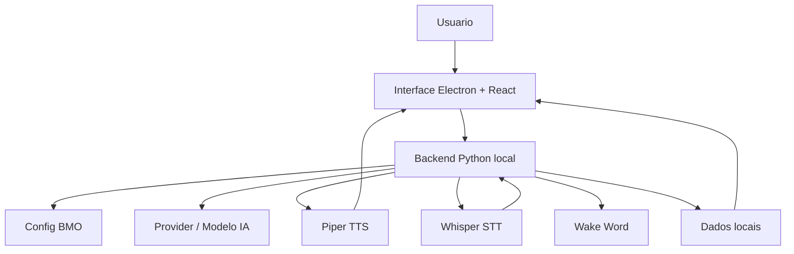

# BMO 1.0 - Documentacao Profissional

## Visao geral

BMO e um assistente de IA desktop para Windows com interface Electron + React, backend Python local e integracao com provedor de modelo via API. O objetivo do BMO 1.0 e entregar um assistente visualmente vivo, com voz, microfone, lembretes, memoria, historico, tarefas, ferramentas e configuracao por interface.

O usuario final deve precisar apenas instalar o aplicativo, abrir o BMO, configurar sua chave de API e usar.

## Arquitetura

Fluxo principal:



## Componentes

- Frontend: React + Vite em `src/`.
- Desktop shell: Electron em `electron/main.cjs`.
- Backend local: Python em `backend/bmo_backend.py`.
- Configuracao principal: `config/app_config.json`.
- Configuracao do agente/modelo: `config/nanobot_config.json`.
- Runtime de voz: `runtime/piper/`.
- Runtime de transcricao: `runtime/whisper.cpp/`.
- Sons do BMO: `runtime/sounds/`.
- Dados do usuario: `%LOCALAPPDATA%\BMO`.

## Requisitos para desenvolvimento

- Windows 10 ou superior.
- Node.js instalado.
- Python instalado no ambiente de desenvolvimento.
- Dependencias Python usadas pelo backend.
- PyInstaller para gerar `bmo_backend.exe`.
- Electron Builder para gerar instalador Windows.

O instalador final foi projetado para nao exigir Node.js nem Python na maquina do usuario.

## Instalacao para usuario final

1. Execute o instalador `BMO-v1.0.0-x64-setup.exe`.
2. Escolha a pasta de instalacao.
3. Aguarde a copia dos runtimes e recursos.
4. Abra o BMO pelo atalho da area de trabalho ou menu iniciar.
5. Na primeira abertura, configure a chave API em `Provedores`.

## Configuracao inicial

Abra a aba `Provedores`:

1. Selecione o provedor, por exemplo `openrouter`.
2. Cole sua chave API.
3. Clique em salvar.
4. Use `Testar conexao` para validar.

Abra a aba `Modelos`:

1. Escolha ou digite o modelo desejado.
2. Salve o modelo.
3. Reinicie servicos se solicitado.

Abra a aba `Voz`:

1. Escolha uma voz Piper.
2. Clique em testar voz.
3. Para adicionar novas vozes, coloque arquivos `.onnx` em `runtime/piper/`.

## Uso diario

### Chat

Digite uma mensagem no campo inferior e pressione enviar.

Exemplos:

- `BMO, pesquise sobre IA local`
- `Crie uma tarefa para revisar meus arquivos`
- `Me explique este codigo`
- `Me lembre de tomar agua daqui 10 minutos`

### Voz

Use o botao de microfone ou wake word quando configurado.

O fluxo de voz:

1. BMO escuta.
2. Whisper transcreve.
3. O backend envia para o modelo.
4. Piper gera voz.
5. BMO fala e anima a expressao.

### Lembretes

Formatos suportados:

- `me lembre de tomar remedio daqui 5 minutos`
- `me lembre de tomar agua em 10 minutos`
- `me lembre de ligar para joao hoje as 20h`
- `me lembre de pagar conta amanha as 9`

Quando o lembrete dispara:

- aparece aviso visual;
- toca som curto;
- BMO fala o lembrete;
- permite concluir ou adiar.

### Comandos uteis

- `testar voz`
- `testar lembrete em 10 segundos`
- `/status`
- `/history`
- `/restart`

## Dados e persistencia

Os dados ficam em:

`%LOCALAPPDATA%\BMO`

Arquivos principais:

- `history.json`: historico de conversas.
- `memory.json`: memorias estruturadas.
- `MEMORY.md`: notas de memoria em texto.
- `reminders.json`: lembretes.
- `tasks.json`: tarefas.
- `subagents.json`: subagentes.
- `bmo_backend.log`: logs do backend.
- `voice/`: arquivos WAV gerados.

## Tema visual

O BMO 1.0 inclui o tema `Verde LED`, com:

- paleta neon verde;
- fundo do quarto do BMO com opacidade leve;
- BMO central menor e proporcional;
- paines glassmorphism;
- monitores ECG para CPU, memoria e rede;
- layout responsivo.

## Dependencias empacotadas

O instalador deve incluir:

- Electron e Chromium embutidos.
- Backend Python empacotado como `bmo_backend.exe`.
- Piper TTS.
- Modelos Piper.
- Whisper.cpp.
- Sons do BMO.
- FFmpeg.
- Configuracoes padrao.
- VC++ Redistributable quando disponivel em `build-support/redist`.

## Build de desenvolvimento

Instalar dependencias:

```powershell
npm install
```

Rodar frontend:

```powershell
npm run dev
```

Rodar Electron:

```powershell
npm run electron
```

Build do frontend:

```powershell
npm run build
```

## Gerar instalador Windows

Use:

```bat
build-electron.bat
```

Esse script:

1. Empacota o backend Python com PyInstaller.
2. Gera o frontend.
3. Gera o instalador Electron com NSIS.

Saida esperada:

`electron-release/BMO-v1.0.0-x64-setup.exe`

## Testes antes de aprovar

Checklist minimo:

- abrir o BMO sem terminal visivel;
- som de inicializacao toca;
- `testar voz` funciona;
- `testar lembrete em 10 segundos` dispara;
- chat responde;
- historico salva conversa;
- memoria abre e salva;
- Piper aparece online;
- Whisper aparece online;
- CPU/memoria/rede mostram dados;
- tema Verde LED abre corretamente;
- fechar no X minimiza para bandeja;
- sair completamente pela bandeja.

## Solucao de problemas

### Sem voz

Verifique:

- `runtime/piper/piper/piper.exe`
- modelo `.onnx` em `runtime/piper/`
- logs em `%LOCALAPPDATA%\BMO\bmo_backend.log`

Procure linhas com:

`[AUDIO]`

### Lembrete nao dispara

Verifique:

- `%LOCALAPPDATA%\BMO\reminders.json`
- se o backend esta rodando em `127.0.0.1:8787`
- logs `reminder scheduler check`

### App nao responde

Use a aba `Sistema` e clique em reiniciar servicos.

### Provider nao conecta

Verifique:

- chave API;
- modelo ativo;
- internet;
- endpoint do provedor.

## Status BMO 1.0

Esta versao foi preparada como base final do BMO 1.0 para testes em PC limpo. A aprovacao final depende da bateria de testes em VM ou maquina sem ambiente de desenvolvimento.
