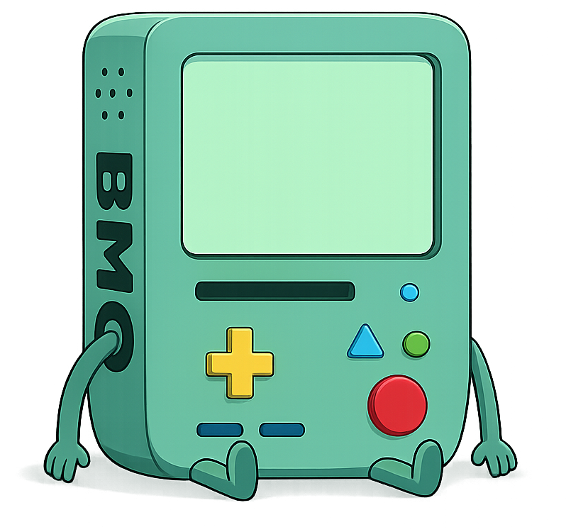

<div align="center">
  
  <h1>BMO Desktop</h1>
  <p><strong>Seu assistente de IA local com voz, memória e ferramentas</strong></p>
  <p>
    <a href="#instalacao">Instalação</a> •
    <a href="#docs">Documentação</a> •
    <a href="#build">Build</a> •
    <a href="#licenca">Licença</a>
  </p>
</div>

---

## ✨ O que é o BMO?

O **BMO** é um assistente de IA desktop completo que roda **localmente no seu computador**. Ele combina:

- 🧠 **IA conversacional** via Nanobot (OpenRouter, OpenAI, Anthropic, Ollama…)
- 🗣️ **Voz natural** com Piper TTS (texto para fala)
- 🎙️ **Reconhecimento de fala** com Whisper (fala para texto)
- 🛠️ **Ferramentas**: busca web, execução de código, arquivos, cron, subagentes
- 💾 **Memória persistente**: o BMO lembra de você entre sessões
- 🔌 **Canais**: Telegram, Discord, WhatsApp, Email e mais

> Interface com tema do BMO (Hora de Aventura), com suporte a português e inglês.

---

## 📸 Captura de Tela

O BMO roda em uma janela desktop com tema escuro, sprites animados do BMO e painéis de configuração completos.

---

<h2 id="instalacao">📦 Instalação Rápida</h2>

### Windows

1. **Baixe o instalador** mais recente da página de releases
2. Execute `BMO Setup.exe`
3. Siga o assistente (caminho padrão: `C:\Program Files\BMO`)
4. Abra o BMO pelo atalho na Área de Trabalho

> ⚠️ **Pré-requisitos**: Windows 10 ou superior, 4 GB de RAM, 2 GB de espaço em disco.

### A partir do código

```bash
git clone https://github.com/seu/bmo.git
cd bmo
npm install
pip install -r requirements.txt
npm run build
npm run electron:build
```

---

## 🚀 Primeiros Passos

1. **Abra o BMO**
2. **Configure sua chave de API** no painel Provedores (OpenRouter recomendado)
3. **Escolha um modelo de IA** (ex: `openai/gpt-oss-120b:free`)
4. **Converse!** Digite sua mensagem ou clique no microfone para falar

> 💡 Sem chave de API configurada, o BMO pode usar modelos locais via Ollama.

---

## 🧩 Funcionalidades

| Funcionalidade | Descrição |
|---|---|
| 💬 **Chat** | Conversa natural com IA via texto ou voz |
| 🗣️ **Voz Piper** | Texto para fala em português e inglês |
| 🎙️ **Whisper** | Reconhecimento de fala local (microfone) |
| 🧠 **Memória** | O BMO lembra fatos, preferências e projetos |
| 🌐 **Busca Web** | Pesquisa na internet e lê páginas |
| 📁 **Arquivos** | Criar, editar, ler arquivos no workspace |
| ⚡ **Execução** | Rodar código Python, shell e scripts |
| 🤖 **Subagentes** | Tarefas longas em background |
| ⏰ **Cron** | Agendamento de tarefas |
| 📦 **Skills** | Instalar habilidades prontas |
| 🔌 **Canais** | Telegram, Discord, WhatsApp, Email... |

---

<h2 id="docs">📚 Documentação Completa</h2>

Toda a documentação está em `docs/`:

| Documento | Público | Conteúdo |
|---|---|---|
| [`docs/INSTALLATION.md`](./docs/INSTALLATION.md) | Usuário | Instalação passo a passo no Windows |
| [`docs/CONFIGURATION.md`](./docs/CONFIGURATION.md) | Usuário | Configuração de provedores, voz, canais |
| [`docs/VOICE_SETUP.md`](./docs/VOICE_SETUP.md) | Usuário | Configurar microfone, vozes, wake word |
| [`docs/WORKSPACE.md`](./docs/WORKSPACE.md) | Usuário | Gerenciar arquivos e workspace |
| [`docs/MEMORY.md`](./docs/MEMORY.md) | Usuário | Memória e preferências |
| [`docs/TOOLS_AND_SKILLS.md`](./docs/TOOLS_AND_SKILLS.md) | Usuário | Ferramentas e skills instaláveis |
| [`docs/TROUBLESHOOTING.md`](./docs/TROUBLESHOOTING.md) | Usuário | Solução de problemas comuns |
| [`docs/ARCHITECTURE.md`](./docs/ARCHITECTURE.md) | Dev | Arquitetura do sistema |
| [`docs/BUILD_WINDOWS.md`](./docs/BUILD_WINDOWS.md) | Dev | Como compilar o instalador |
| [`docs/CHANGELOG.md`](./docs/CHANGELOG.md) | Todos | Histórico de versões |
| [`docs/ROADMAP.md`](./docs/ROADMAP.md) | Todos | Próximos passos do projeto |
| [`docs/TESTING_VM.md`](./docs/TESTING_VM.md) | Dev | Teste em máquina virtual limpa |

---

<h2 id="build">🔧 Build do Instalador</h2>

```bash
npm run build          # compila frontend
npm run electron:build # gera o instalador NSIS
```

O instalador será gerado em `electron-release/BMO Setup.exe`.

---

## 🛡️ Privacidade

- O BMO roda localmente no seu computador
- Nenhum dado é enviado para servidores externos (exceto chamadas de API ao provedor de IA escolhido)
- As chaves de API ficam armazenadas localmente em arquivo de configuração
- Você controla quais canais e ferramentas estão ativos

---

<h2 id="licenca">📄 Licença</h2>

Este projeto utiliza componentes de terceiros. Consulte [`NANOBOT_THIRD_PARTY_NOTICES.md`](./NANOBOT_THIRD_PARTY_NOTICES.md) para detalhes.

---

<div align="center">
  <sub>Feito com 💚 por fãs do BMO • Hora de Aventura</sub>
</div>
